# Video Configuration

Below you can find a description of some basic video configurations and features on RePlayOS. You can change the resolution, add some video filters, select different scaling modes, enable dual screen, and more.

## Preferred Renderer and Frame Pacing

`REPLAY OPTIONS > VIDEO > PREFERRED RENDERER` defaults to OpenGL ES. Users on Raspberry Pi 5 can select experimental Vulkan without an Insider token. This is a preference for Vulkan-capable cores; OpenGL ES cores and software-frame cores continue through their supported paths. Changing the renderer requires a game restart.

`REPLAY OPTIONS > VIDEO > FRAME PACING` offers `BALANCED` (default, best performance) and `LOW LATENCY` (which may reduce performance). A running game's `SYSTEM SETTINGS > FRAME PACING` option can override the global choice. Apply a changed frame-pacing setting by restarting the game.

## Video Connector

* `HDMI`: used for both HDMI>LCD and HDMI>DAC>CRT modes
* `DPI (GPIO)`: enables limited support for legacy RGB-Pi (GPIO) model in Raspberry Pi5 (must be enabled from `REPLAY OPTIONS > SYSTEM > PI5 ADD-ON`)
    - Pi5 only
    - No audio support
    - Supports both LCD and CRT modes (defaults to CRT)
    - Supports stable interlaced mode in CRT 15KHz mode
    - Interlaced requires [EEPROM Update](eeprom.md) >= 2025-11-05 (see note below)
    - Provides its own EDID information:
        Monitor name: RPI-DPI-VGA
        Vendor: RTA
        Supported VGA modes:
        ```sh
            Mode 0: 1920x1080@60 
            Mode 1: 1920x1080@50 
            Mode 2: 1280x720@60 
            Mode 3: 1280x720@50 
            Mode 4: 1024x768@75 
            Mode 5: 1024x768@70 
            Mode 6: 1024x768@60 (*)
            Mode 7: 800x600@75 
            Mode 8: 800x600@60 
            Mode 9: 640x480@75 
            Mode 10: 640x480@60 
            Mode 11: 640x480@60 
            Mode 12: 720x400@70
        ```
**NOTE:** RePlayOS checks the EEPROM minimum version and shows a warning when an update is required. It does not install EEPROM updates automatically. Please check the [EEPROM Update](eeprom.md) section for deliberate manual updates.

## Video Mode

You can select the desired video mode from `REPLAY OPTIONS > VIDEO > VIDEO MODE`:

* `CRT/LCD AUTO`: this mode automatically selects the type (CRT or LCD), and native resolution of your monitor. However, please note that this only applies to resolutions up to 1920x1080 for LCD. This limitation ensures backward compatibility with all Raspberry Pi models and addresses performance considerations. Consequently, even if you have a 4K monitor, the system will configure it to a maximum resolution of 1920x1080.
* `CRT 320X240 GRR`: this enables analog video support in 240p mode, which is the standard for a commercial CRT TV. It uses the game refresh rate (**GRR**) for each system/game and can scale to 480p with suitable high-resolution arcade 31kHz monitor profiles.
* `LCD GRR`: this mode uses your monitor’s native resolution and the game refresh rate (**GRR**) for different systems and games when available. The refresh rate selected depends on the [LCD monitor type](#lcd-type) chosen in the corresponding option.
* `LCD 1920X1080@60`
* `LCD 1280X720@60`
* `LCD 1280X1024@60`
* `LCD 1024X768@60`
* `LCD 2560x1440@60`: experimental 2K resolution for Raspberry PI 5 and higher (can impact performance).
* `LCD 3840x2160@60`: experimental 4K resolution for Raspberry PI 5 and higher (can impact performance).
* `LCD 1920X1200@60`: 16:10 hi-res for Raspberry PI 4 and higher (can impact performance).

**NOTE:** video connector, video mode, multi-screen, LCD type, and CRT type changes are applied live. RePlay shows a three-second cancellation countdown before rebuilding the video stack.

## Multi Screen

RePlayOS is able to make use of dual screen configuration in both LCD and CRT configurations. You can select different modes from `REPLAY OPTIONS > VIDEO > MULTI SCREEN`:

* `DISABLED`: for single screen configuration.
* `DUAL DUPLICATE`: clones the image in both screens. Useful for streaming or recreating arcades like Sega Versus City. 
* `DUAL HORIZONTAL`: uses both screens in horizontal extended way. Useful for dual screen arcade games like Sagaia or OutRunners.
* `DUAL VERTICAL`: uses both screens in vertical extended way. Useful for arcades like Punch-Out or Nintendo DS.
* `DUAL SMART OUTPUT`: horizontal and vertical games will be displayed in different screens (when supported).

## LCD Type

Allows you to choose different TV and monitor types.

* `TV & PC 60Hz`: choose this if your monitor does not support VRR. Supported native refresh rates: 55-61 Hz.
* `TV & PC VRR`: choose this if your monitor supports VRR. Supported native refresh rates: 48-75 Hz.

## CRT Type

Allows you to choose different TV and monitor types. Choose TV 15kHz for regular TVs.

## CRT CSYNC Mode

This option is only available on RGB-Pi compatible hardware. It allows you to select different methods for generating the composite sync (CSYNC) video signal:

* `AND`:
The CSYNC signal is generated by logically AND-ing the horizontal and vertical sync signals. This is the most common mode used by many original hardware and is widely compatible with most CRT TVs.

* `XOR`:
The CSYNC signal is generated by logically XOR-ing (exclusive OR) the horizontal and vertical sync signals. This can be required or preferred by certain hardware, such as some PVM, BVM, or PC/arcade monitors.

**NOTE:** Select the mode required by your display or hardware. Using the wrong mode may result in no video output or unstable display.

## CRT RGB Color Range

Selects the RGB color range for video output. This option determines how color values are mapped to the CRT analog video signal and can affect black levels and color accuracy, depending on your video DAC.

* **AUTO | DEFAULT**
The system tries to automatically selects the optimal RGB range based on the detected video DAC. This is the recommended setting for most users.

* **FULL | RGB RANGE 0:255**
Outputs the full RGB range, where black is 0 and white is 255. Use this with compatible video DACs that expect full-range RGB signals.

* **LIMITED | RGB RANGE 16:235**
Outputs the limited RGB range, where black is 16 and white is 235. This matches the standard range used in broadcast video (e.g., TV and DVD). Use this setting with cheap video DACs, like the AG6200, expecting limited-range signals to avoid washed-out blacks or crushed whites.

**NOTES:**

* Using the wrong range may result in washed-out or overly dark images. If you are unsure, leave this setting on **AUTO**.
Certainly. Here’s a more concise and technically clear version:
* The `SCREEN_TEST` utility, located in the `REPLAY EXTRA` folder, provides an easy way to determine if your DAC outputs a limited color range. The color bar pattern includes a small yellow arrow indicating the threshold where most limited-range DACs begin to show distinct color levels. To test, increase your TV’s brightness to maximum—if the area to the left of the arrow remains completely black, your DAC is likely outputting a limited color range.

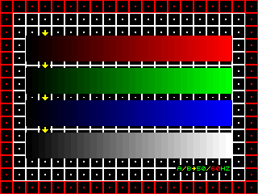{width="768"}

## CRT Horizontal Shift

This option lets you adjust the horizontal image position by changing the horizontal timing so the electron beam scans slightly left or right.

## CRT Horizontal Size

Adjusts the image’s horizontal size (width) by changing the active video time per line, i.e., the horizontal hactive/porches and pixel clock.

## Gamma, RGB Color Intensity and Screen X/Y Position

You can fully customize various screen parameters, such as gamma, RGB color channel intensity (to adjust CRTs with degraded channels), and screen position on both LCD and CRT displays.

## Integer Scale

This allows you to choose different display modes when playing on LCD screens (CRT always uses a native resolution and aspect ratio) from `REPLAY OPTIONS > VIDEO > INTEGER SCALE`:

* `DISABLED`: Displays the game image using the core provided aspect ratio (aspect is controlled by core option).
* `VERTICAL`: Scales the vertical resolution using an integer factor while maintaining the horizontal core provided aspect ratio.
* `HORIZONTAL`: Scales the horizontal resolution using an integer factor while maintaining the vertical core provided aspect ratio.
* `FULL`: Performs an integer scale to the maximum area allowed by the screen resolution.
* `FULL OVERSCAN`: Uses an integer overscaling mode to extend the image over 1080p, nearly displaying the original overscan of a CRT. This works only with 1080p video modes.

| **DISABLED** | **FULL** |
|:----------------------------------:|:------------------:|
| 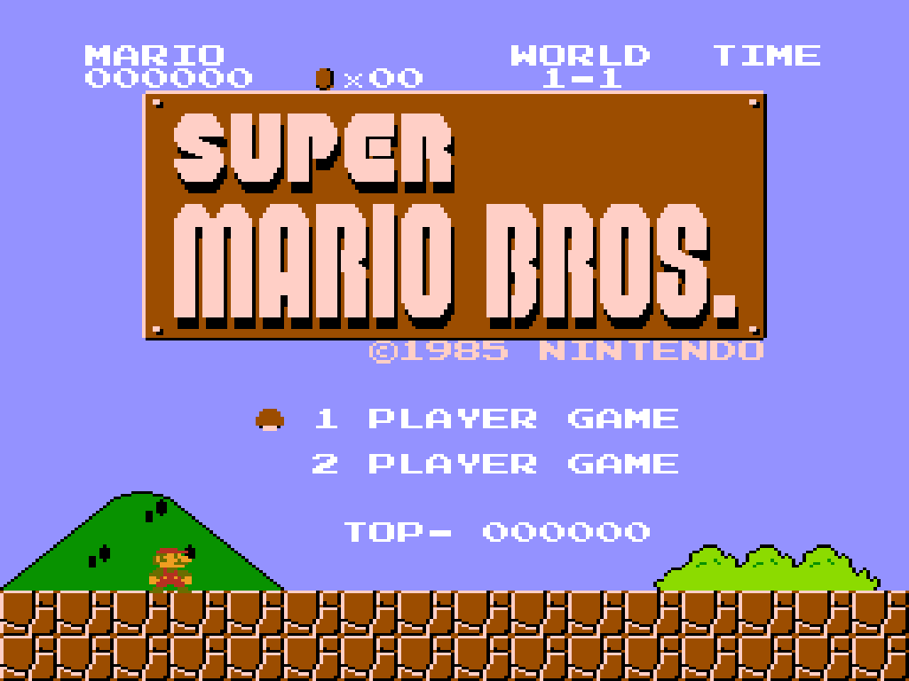{width="360"} | 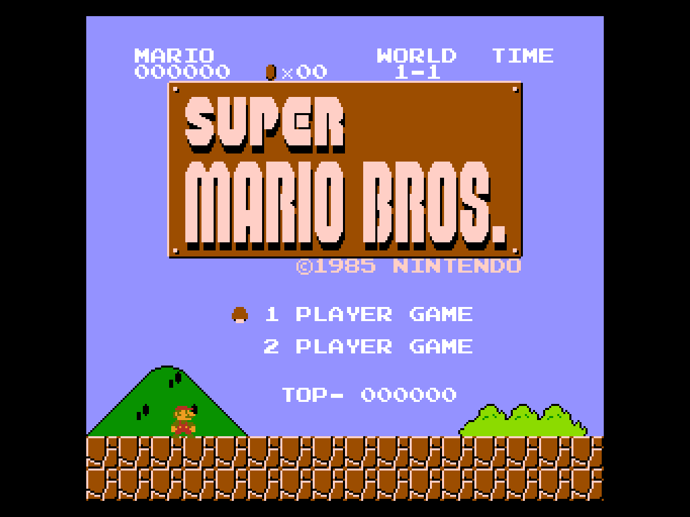{width="360"} |

## AmbiScan

This option adds an adaptative color decoration effect to your games.


## Display Filter

`REPLAY OPTIONS > VIDEO > DISPLAY FILTER` controls the texture of the emulated screen. It replaces the old `SCANLINES` option and is available on Raspberry Pi 4 and newer, with OpenGL ES and the supported Pi5 Vulkan renderer.

Choose one display preset, or leave it **Disabled** for the original screen texture. Display filters apply to LCD output and supported 31kHz CRT modes; native 15kHz CRT output already has its own physical scanlines. **Integer scaling is not required.** The presets follow native game pixels through scaling, cropping and rotation, while the CRT phosphor mask stays aligned to the physical screen.

| Preset | Appearance |
|:-------|:-----------|
| **Disabled** (default) | No simulated scanlines, phosphor mask or LCD matrix. |
| **Scanlines Light** | Subtle scanline texture. |
| **Scanlines Medium** | Moderate scanline contrast. |
| **Scanlines Strong** | More pronounced scanline contrast. |
| **Scanlines Maximum** | The strongest brightness-adaptive preset; replaces the old Black name. |
| **CRT TV** | Medium scanlines with a fine phosphor mask for a generic CRT TV appearance. |
| **LCD Grid Dark** | Dark gaps around each native game pixel. |
| **LCD Grid Light** | Light gaps around each native game pixel, inspired by the Game Boy Color matrix. |
| **LCD RGB** | A pixel grid with red, green and blue subpixel stripes. |
| **LCD BGR** | The same layout with the stripe order reversed; the game's colour channels are not swapped. |
| **LCD DMG** | Lightly shaded dots with light gaps, inspired by the original Game Boy's reflective display. |

Scanlines and LCD cells are resolution independent: their alignment follows the source raster rather than a fixed output resolution. Fine detail fades when the output cannot resolve it. Fractional-scale filtering reduces moiré, but the visible result still depends on scaling and your monitor.

Select any screenshot below to view the original image. Browser resizing can change the appearance of fine scanlines and pixel grids.

### Scanlines

The four presets share a brightness-adaptive beam profile. Bright and saturated pixels have wider beams, while darker pixels have more visible gaps. Maximum is the strongest preset, rather than a guarantee of completely black gaps. Scanlines fade at low scales and disappear at 1x or when downscaling.

<a id="scan-lines"></a>

| **Scanlines Light** | **Scanlines Medium** |
|:-------------------:|:--------------------:|
| [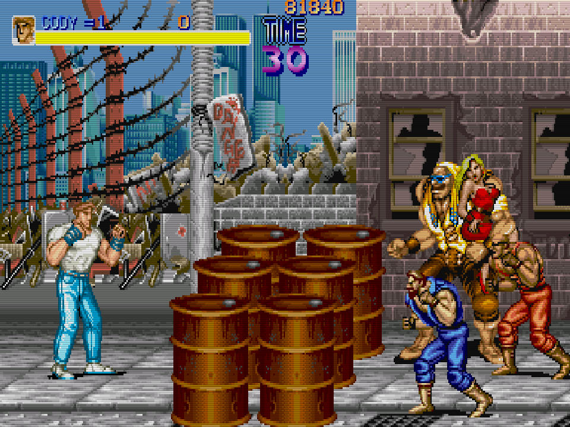{width="360" loading="lazy"}](img/filters/scanlines_light.png) | [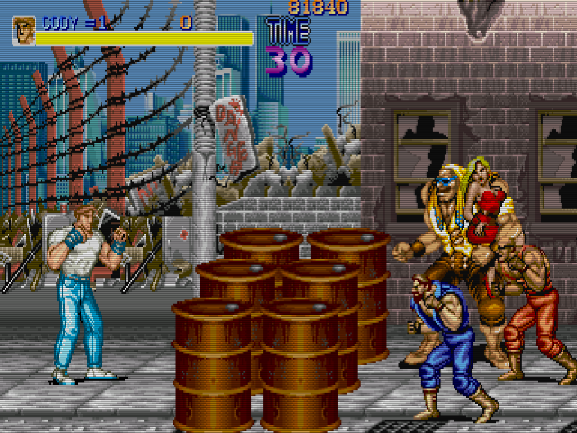{width="360" loading="lazy"}](img/filters/scanlines_medium.png) |
| **Scanlines Strong** | **Scanlines Maximum** |
| [{width="360" loading="lazy"}](img/filters/scanlines_strong.png) | [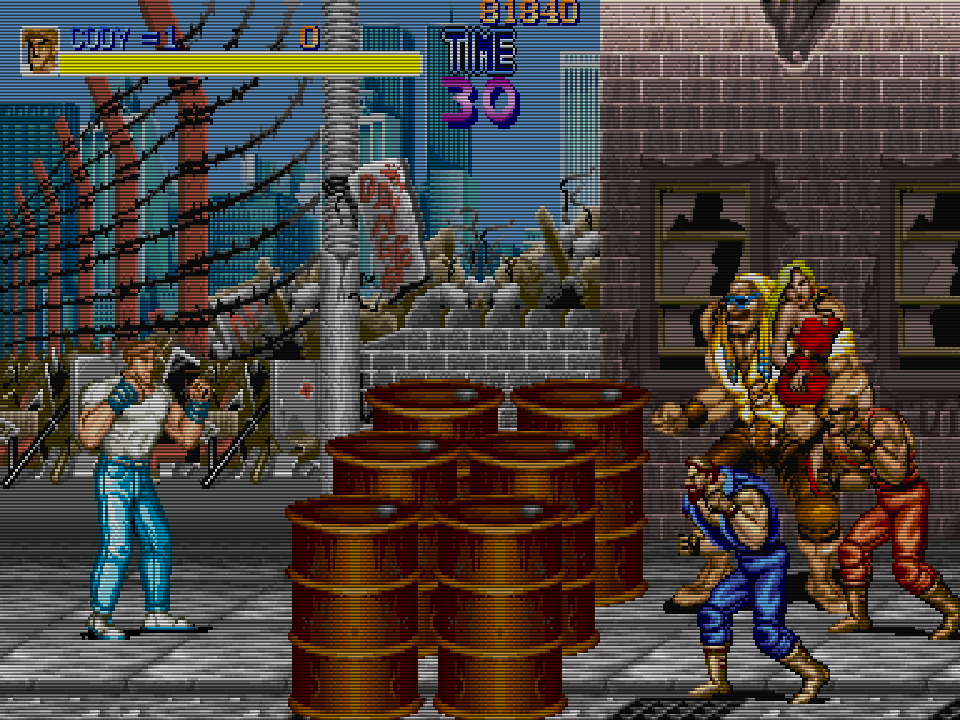{width="360" loading="lazy"}](img/filters/scanlines_maximum.png) |

### CRT TV

CRT TV combines Medium scanlines with a subtle, screen-aligned phosphor mask. It provides a lightweight CRT-style texture rather than reproducing a particular television model. Its appearance can vary with the monitor's subpixel layout.

[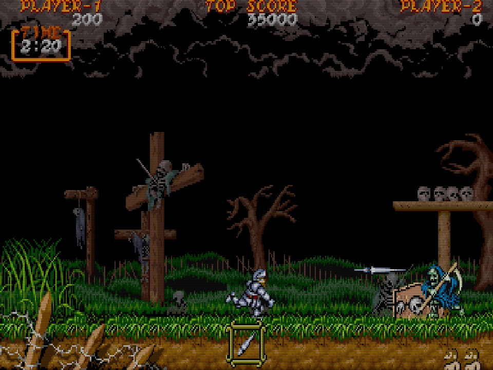{width="720" loading="lazy"}](img/filters/crt_tv.png)

### LCD Grid Dark and Light

Both grid presets outline native game pixels. Dark darkens the gaps and retains pure black; Light brightens the gaps and retains full white. The light matrix gives a Game Boy Color-inspired appearance, while both presets can be used with other systems.

The grids use smooth profiles to reduce visible bands at fractional scales. Their contrast fades between 3x and 2x and disappears at 2x or below.

| **LCD Grid Dark** | **LCD Grid Light** |
|:-----------------:|:------------------:|
| [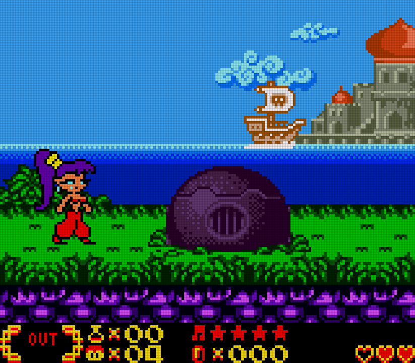{width="360" loading="lazy"}](img/filters/lcd_grid_dark.png) | [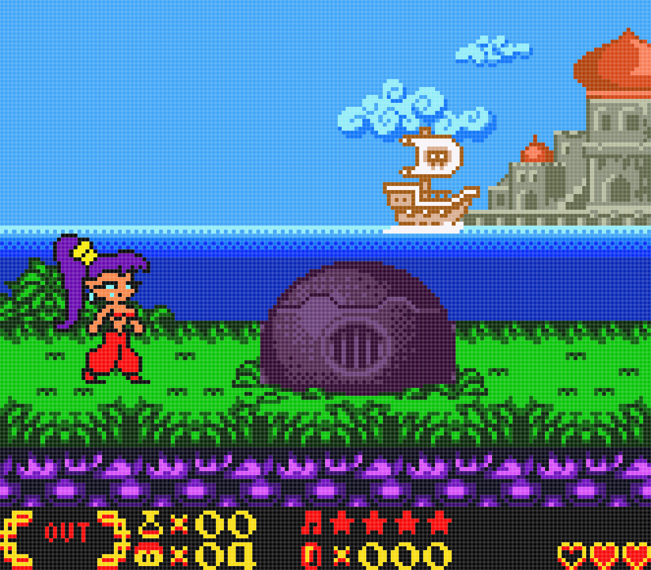{width="360" loading="lazy"}](img/filters/lcd_grid_light.png) |

### LCD RGB and BGR

These presets add coloured subpixel stripes inside each native pixel. RGB and BGR differ only in stripe order; choose the appearance you prefer on your monitor. The stripe layout rotates with the game.

Colour stripes need more horizontal resolution than a simple grid. They fade between 6x and 3x along the source's horizontal axis. At lower scales, only a subtle neutral grid remains, fading out as the output approaches 1x.

| **LCD RGB** | **LCD BGR** |
|:-----------:|:-----------:|
| [{width="360" loading="lazy"}](img/filters/lcd_rgb.png) | [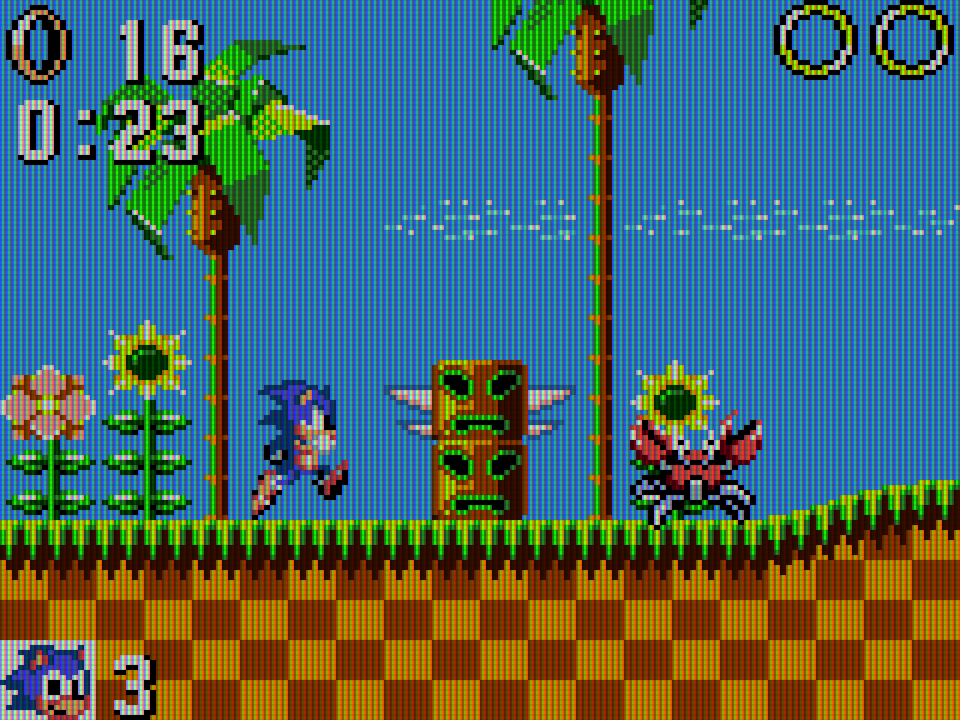{width="360" loading="lazy"}](img/filters/lcd_bgr.png) |

### LCD DMG

LCD DMG adds a faint shade inside each dot and a lighter matrix between dots. The gaps are most visible in dark areas and become subtle in highlights. At small scales, the grid fades out but the faint surface shade remains.

**All LCD presets retain the core's selected palette.** DMG does not force a green tint: select green, grey or another palette in the core's settings. These presets simulate the pixel matrix without adding ghosting or slow LCD response.

[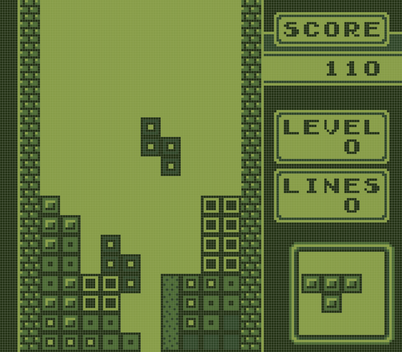{width="520" loading="lazy"}](img/filters/lcd_dmg.png)

## Analog Filter

`REPLAY OPTIONS > VIDEO > ANALOG FILTER` controls signal characteristics independently of Display Filter. It is available on Raspberry Pi 4 and newer, including CRT output, and works with NTSC and PAL content across systems. Integer scaling is not required.

| Mode | Effect |
|:-----|:-------|
| **Disabled** (default) | Displays the core's image without frontend analog processing. |
| **RGB** | Sharp RGB reconstruction without composite colour bleed or luminance/chroma interference. |
| **S-Video** | Separate luminance/chroma filtering with colour bleed, retaining more fine detail than Composite. |
| **Composite** | Colour bleed and luminance/chroma interference for a softer composite-video appearance. |
| **Dither Blending** | custom blending for pixel patterns used to create transparency or additional colours. |

RGB, S-Video and Composite use the same display-RGB colour mapping for every system. Dither Blending blends alternating patterns such as those used in Sonic's waterfall while retaining flat areas; fine details and text can also soften. RGB still performs reconstruction and colour quantization, so use Disabled if you want no frontend analog processing.

The captures below show all four active modes:

| **RGB** | **S-Video** |
|:-------:|:-----------:|
| [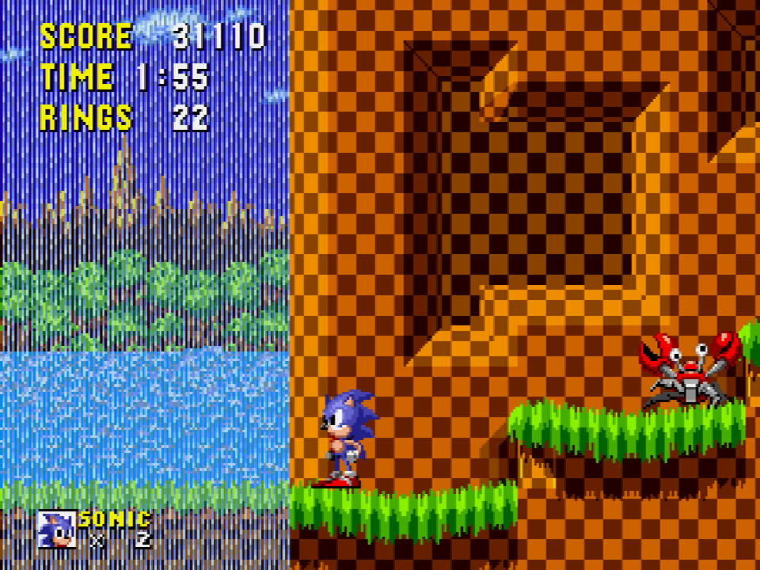{width="360" loading="lazy"}](img/filters/rgb.png) | [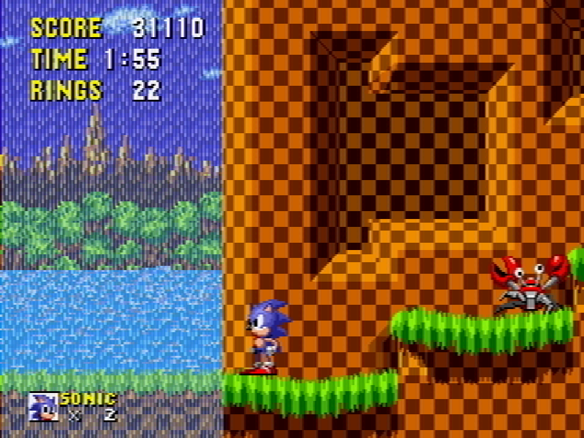{width="360" loading="lazy"}](img/filters/s-video.png) |
| **Composite** | **Dither Blending** |
| [{width="360" loading="lazy"}](img/filters/composite.png) | [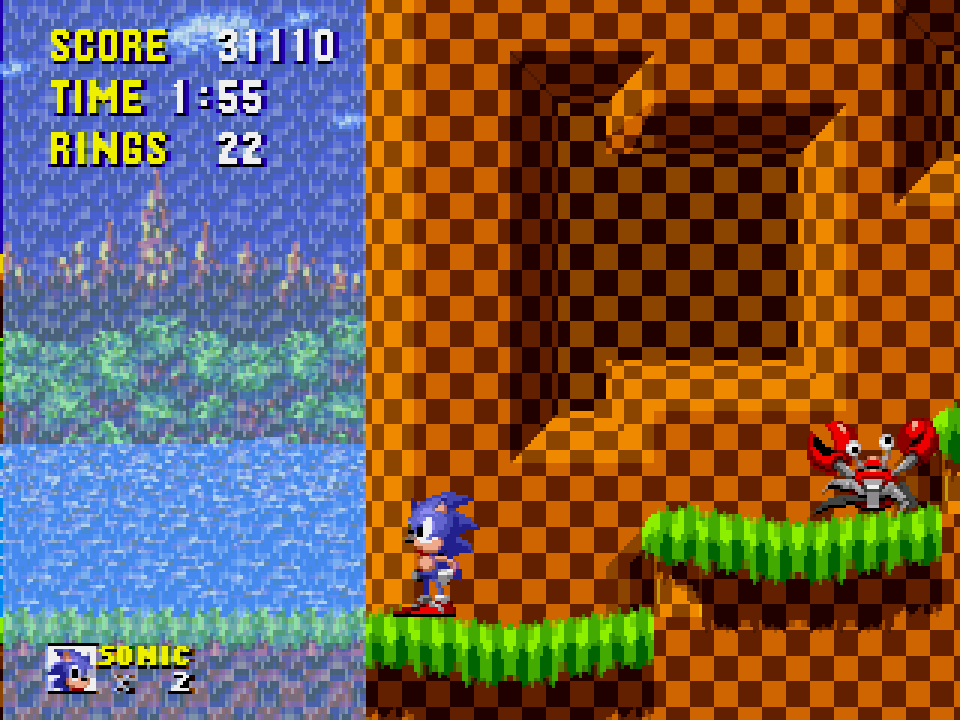{width="360" loading="lazy"}](img/filters/dither_blending.png) |

## Combining Filters and Saving Settings

Display Filter and Analog Filter can be selected independently. For example, combine Composite with CRT TV, or Dither Blending with a scanline preset. LCD presets replace the other display presets rather than stacking with them; they can still be combined with an analog mode.

Changes apply live. Use the global Video options or the system, folder and game overrides. An override set to **Default** inherits the applicable parent setting. The configuration keys are `video_filter` and `video_analog_filter` globally, and `replay_video_filter` and `replay_video_analog_filter` in overrides. See the [configuration reference](cfgfile.md) for numeric values and the [REST API reference](rest_api.md#core-folder-and-game-config) for managed overrides.

## Filter Performance

The filters process the current frame without buffering an extra frame. Display filters reuse the game draw; analog filters use one additional pass. They still add GPU work: display-filter cost grows with the output viewport, while analog-filter cost grows with the native game resolution.

Dither Blending is the cheapest active analog mode. In standalone Pi5 GPU measurements at 320×224, it took about 0.19 ms, compared with about 0.8 ms for RGB, S-Video or Composite, excluding the final display draw. Processing at higher native resolutions costs substantially more. LCD RGB/BGR have optimized stripe rendering, but remain more expensive than scanlines.

For demanding games, start with 1080p output and lighter filters. At a 2880×2160 game viewport, measured Pi5 display draws with heavy masks exceeded the 16.67 ms budget for 60 Hz before emulation and other rendering. GPU timings are not controller-to-screen latency measurements; maintaining full speed and avoiding missed presentation deadlines still matters.

## HDMI CEC

This option enables HDMI CEC (Consumer Electronics Control) functionality, which requires a modern TV with CEC support. When enabled, it allows the system and TV to communicate for features such as automatic power on/off and control of the UI menus using the TV remote—ideal for seamless operation with the Alpha Player.
